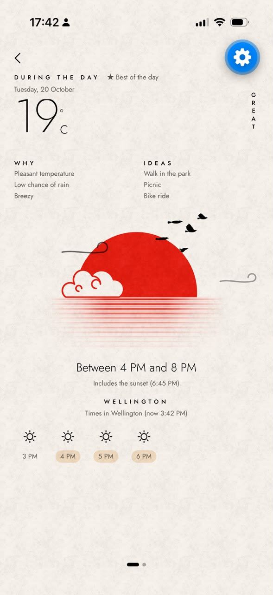
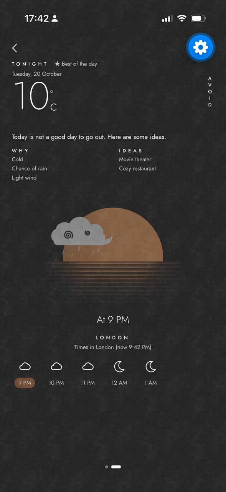
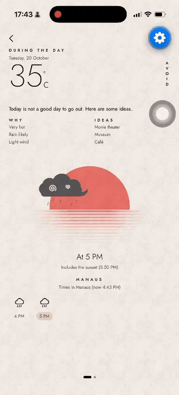
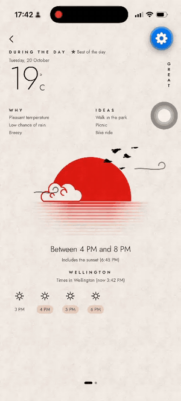
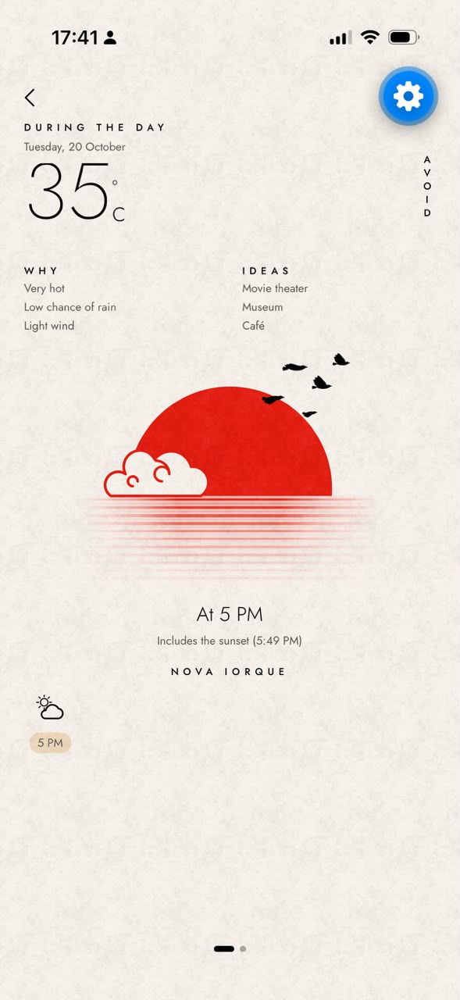

# Best Time Outside

App em React Native que responde a uma pergunta simples: **qual o melhor horário para sair hoje?**

Você busca uma cidade, e o app transforma a previsão horária da [Open-Meteo](https://open-meteo.com/) em uma recomendação: _"Ótimo entre 16h e 19h. Temperatura agradável, baixa chance de chuva e vento leve."_, com sugestões do que fazer nesse horário.

<table>
  <tr>
    <td align="center"><br /><sub>Busca com cidades recentes</sub></td>
    <td align="center"><br /><sub>Dia ótimo, com a faixa recomendada</sub></td>
    <td align="center"><br /><sub>Noite chuvosa, modo escuro</sub></td>
  </tr>
  <tr>
    <td align="center"><br /><sub>Chuva: sugestões indoor</sub></td>
    <td align="center"><br /><sub>Vento: rajadas na cena</sub></td>
    <td align="center"><br /><sub>Calor forte: "Evite"</sub></td>
  </tr>
</table>

## Como rodar

### Pelo celular, sem instalar nada (Android)

Baixe o APK: **[best-time-outside.apk](https://expo.dev/artifacts/eas/0H6Sd65q9KopIuW1DvqmuHpSMoXSPI9kZUhCheuKKq8.apk)** (build `preview` do EAS; é preciso permitir a instalação de fontes desconhecidas)

### Com Expo Go (iOS e Android)

Pré-requisitos: Node 20+ e o app [Expo Go](https://expo.dev/go) no celular (o projeto usa o **Expo SDK 57**, a versão suportada pelo Expo Go das lojas).

```bash
git clone https://github.com/MateusGuedess/best-time-outside.git
cd best-time-outside
npm install
npx expo start
```

Escaneie o QR code com a câmera (iOS) ou com o Expo Go (Android). Se o celular não estiver na mesma rede do computador, use `npx expo start --tunnel`.

### Scripts

| Comando             | O que faz                                    |
| ------------------- | -------------------------------------------- |
| `npm start`         | Sobe o Metro (Expo)                          |
| `npm test`          | Testes (Jest + React Native Testing Library) |
| `npm run typecheck` | `tsc --noEmit`                               |
| `npm run lint`      | ESLint + Prettier                            |
| `npm run check`     | Os três acima, na mesma ordem do CI          |

## Funcionalidades

- **Busca de cidade** com debounce (350 ms), mínimo de 2 caracteres e cancelamento das requisições antigas. Resultados com estado, país e bandeira, para diferenciar cidades com o mesmo nome.
- **Buscas recentes** salvas no aparelho.
- **Recomendação em duas páginas, dia e noite**, que se alternam deslizando. Cada uma tem a janela recomendada, o rótulo (Ótimo, Bom ou Evite), o motivo em uma frase, avisos (UV alto, possibilidade de chuva) e 2 a 3 sugestões de atividade para aquele horário.
- **Faixa de horas** com a nota de cada hora. Tocar numa hora abre o detalhamento: quanto cada fator pesou na nota.
- **Ilustração animada** que muda com o período (sol ou lua) e com o tempo (céu limpo, chuva, tempestade, vento).
- **Fuso da cidade:** os horários são sempre os da cidade buscada, não os do aparelho.
- **Idioma e unidades do aparelho:** português, inglês e espanhol; °C ou °F; km/h ou mph.
- **Modo claro e escuro**, com tema próprio para o dia e para a noite.
- **Estados de erro tratados:** sem internet, serviço instável, resposta inesperada da API e busca sem resultados, cada um com mensagem e, quando faz sentido, botão de tentar de novo.

## Como o melhor horário é escolhido

A lógica fica em [`src/recommendation/`](src/recommendation/). São funções puras, sem React, que recebem a previsão e o "agora" e devolvem a recomendação.

**1. Horas candidatas.** Só horas que ainda não passaram, no fuso da cidade, em dois períodos:

- **Dia:** da hora atual até o pôr do sol. Se o dia já acabou, usa o dia de amanhã (e a tela avisa).
- **Noite:** do pôr do sol até as 2h.

**2. Nota de cada fator (0 a 1).** Cada fator tem uma faixa ideal (nota 1) e cai em linha reta até 0 nos limites:

| Fator                  | Ideal     | Nota 0 em         |
| ---------------------- | --------- | ----------------- |
| Sensação térmica       | 18–26 °C  | ≤ 8 °C ou ≥ 34 °C |
| Probabilidade de chuva | 0–10%     | ≥ 70%             |
| Vento                  | 0–15 km/h | ≥ 40 km/h         |
| Índice UV (só de dia)  | 0–5       | ≥ 11              |

**3. Nota da hora (0 a 100).**

```
conforto = 0.55 × temperatura + 0.25 × vento + 0.20 × UV     (à noite: 0.70 × temperatura + 0.30 × vento)
nota     = conforto × chuva × ventania × 100
tempestade (weather_code 95–99) → nota 0
```

Temperatura, vento e UV se compensam entre si: um pouco de vento num dia perfeito é tolerável. Já **chuva e ventania multiplicam**, porque são eliminatórias. Com uma média simples, 22 °C com 90% de chuva daria "Bom" e o app mandaria a pessoa sair na chuva.

**4. Janela.** Parte da melhor hora e cresce para as vizinhas enquanto elas estiverem a até 10 pontos da melhor e com nota ≥ 60, até no máximo 4 horas. Assim o app diz "entre 16h e 19h" quando a tarde toda está boa e "às 17h" quando só uma hora se destaca. A janela do dia pode avançar pela noite (um fim de tarde não é cortado no pôr do sol), e a noite usa só as horas que sobraram.

**5. Rótulo, frase e sugestões.** A média da janela vira **Ótimo** (≥ 75), **Bom** (≥ 50) ou **Evite**. A frase sai dos níveis de cada fator ("temperatura agradável", "vento leve"). As sugestões vêm de uma tabela fixa de parte do dia × condição: um fim de tarde agradável sugere parque e bicicleta, e uma noite de "Evite" sugere cinema ou um restaurante aconchegante, para que o pior cenário ainda seja útil.

Os limites e pesos são constantes nomeadas em [`config.ts`](src/recommendation/config.ts), fáceis de calibrar.

## Decisões

Todas as decisões, com alternativas, prós e contras, estão em [`docs/DECISOES.md`](docs/DECISOES.md). Resumo:

| Tema              | Escolha                                    | Por quê, em uma linha                                                                 |
| ----------------- | ------------------------------------------ | ------------------------------------------------------------------------------------- |
| Plataforma        | Expo (managed) + Expo Router               | Roda no Expo Go sem build nativo; rotas por arquivo.                                  |
| Dados do servidor | TanStack Query                             | Cache, cancelamento, retry e estados de carregamento sem reinventar.                  |
| Estado do cliente | Sem lib global                             | O único estado do cliente são as buscas recentes, num hook com AsyncStorage.          |
| HTTP              | `fetch` + wrapper de ~30 linhas            | Timeout, erros tipados e validação num lugar só, sem dependência.                     |
| Validação         | Zod nas respostas da API e no AsyncStorage | Resposta inesperada vira erro tratado, não `undefined` no meio da tela.               |
| Estilo            | NativeWind + tema por variáveis CSS        | Um tema por período (dia/noite) e por esquema (claro/escuro), sem duplicar classes.   |
| Pastas            | Por tipo, com o algoritmo isolado          | Familiar para quem conhece Expo; a regra de negócio fica evidente e testável.         |
| Testes            | Jest + RNTL, foco no algoritmo             | O esforço vai onde está o risco: bordas do algoritmo, fuso, schemas e fluxo de busca. |

## Arquitetura

```
src/
  app/              rotas (Expo Router): busca (index) e recomendação (city/[id])
  components/       componentes do app; ui/ tem os genéricos, sem regra de negócio
  hooks/            useCitySearch, useForecast, useRecentCities, useNow...
  services/         http, clientes da API, query keys, QueryClient
  schemas/          Zod: formato da API → formato do app
  types/            tipos do domínio
  recommendation/   algoritmo (funções puras)
  i18n/             i18next + pt, en, es
  theme/            paleta e tema por período
  __tests__/        testes de tela
```

O fluxo de dados é em camadas, e cada uma só conhece a de baixo:

```
tela → hook (TanStack Query) → service → httpGet (fetch + Zod) → Open-Meteo
tela → recommend(forecast, agora) → Recommendation
```

O formato da Open-Meteo não sai de `schemas/`: o resto do app só usa os tipos de `types/`. Trocar de API afetaria apenas `schemas/` e `services/`.

## Qualidade

- TypeScript em modo `strict` com `noUncheckedIndexedAccess`.
- 235 testes: algoritmo, schemas com respostas reais da API, formatação por fuso e idioma, hooks e as duas telas.
- [GitHub Actions](.github/workflows/ci.yml) roda typecheck, lint e testes em todo push e PR.

## Próximos passos

- Usar a localização atual como ponto de partida.
- Escolher a atividade (correr, pedalar, caminhar) e ajustar os pesos para ela.
- Testes E2E (Maestro) do fluxo principal.

## Créditos

- Dados: [Open-Meteo](https://open-meteo.com/) (Geocoding e Forecast API).
- Fonte: [Jost](https://fonts.google.com/specimen/Jost).
- Visual inspirado nos shots do Dribbble [Simple weather app prototype](https://dribbble.com/shots/14153317-simple-weather-app-prototype) e [Minimal calendar app](https://dribbble.com/shots/11955919-Minimal-calendar-app): papel claro, tipografia fina, sol vermelho com reflexo em linhas. É inspiração, não cópia: as ilustrações e o logo ([`assets/brand/`](assets/brand/)) foram desenhados para este app.
